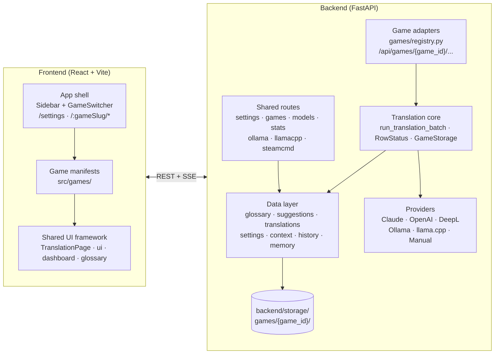
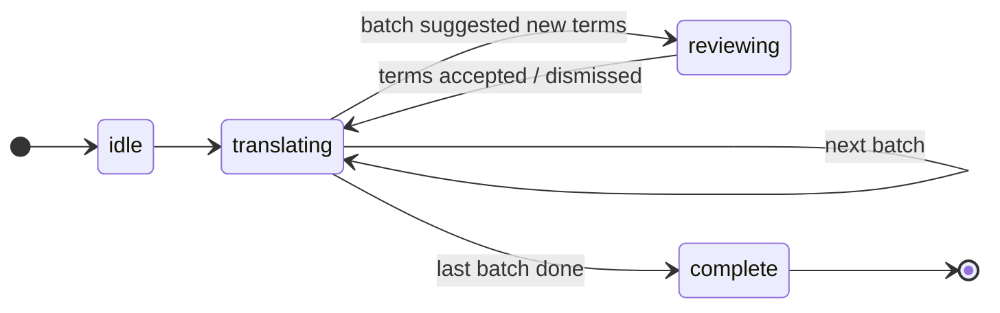

<div align="center">

# Steam Workshop Modding Dashboard

**One dashboard for modding Steam Workshop games.**<br>
Each game plugs in as an adapter and shares an AI translation pipeline, glossary system and UI kit with every other game.

[](https://react.dev/)
[](https://www.typescriptlang.org/)
[](https://vite.dev/)
[](https://fastapi.tiangolo.com/)
[](https://www.python.org/)
[](LICENSE)

[**📖 Wiki**](https://github.com/steve1316/steam-workshop-modding-dashboard/wiki) · [**🚀 Getting Started**](#-getting-started) · [**🧩 Add a Game**](#-adding-a-new-game)

</div>

<table>
  <tr>
    <td></td>
    <td></td>
  </tr>
  <tr>
    <td align="center">Chrono Ark translation page</td>
    <td align="center">Warhammer III translation page, same shared shell</td>
  </tr>
</table>

## 🎮 Supported Games

Each game has its own guide in the [Wiki](https://github.com/steve1316/steam-workshop-modding-dashboard/wiki), covering its pages, file formats, sync behaviour and settings.

| Game | Source → Target | Highlights | Guide |
| --- | --- | --- | --- |
| [**Chrono Ark**](https://store.steampowered.com/app/1188930/Chrono_Ark/) | Korean / Chinese / Japanese / Chinese-TW → English | Every installed Workshop mod. CSV, .NET DLL and GData JSON strings, written back into the mod's files. | [Wiki ↗](https://github.com/steve1316/steam-workshop-modding-dashboard/wiki/Chrono-Ark) |
| [**Total War: Warhammer III**](https://store.steampowered.com/app/1142710/Total_War_WARHAMMER_III/) | Chinese → English | Translation mods for Workshop mods. `.loc.tsv` strings, `.pack` rebuilds via RPFM, Workshop publishing and a compatibility-pack registry. | [Wiki ↗](https://github.com/steve1316/steam-workshop-modding-dashboard/wiki/Total-War-Warhammer-III) |

> [!NOTE]
> The project started as a Chrono Ark-only tool (first `chrono-ark-translator`, then `steam-workshop-mod-translator`) and has grown into a general modding dashboard. More games are on the way.

## Table of Contents

- [Features](#-features)
- [Architecture](#-architecture)
- [Translation Pipeline](#-translation-pipeline)
- [Glossary System](#-glossary-system)
- [Translation Providers](#-translation-providers)
- [Adding a New Game](#-adding-a-new-game)
- [Configuration](#-configuration)
- [Getting Started](#-getting-started)
- [Development](#-development)

## ✨ Features

Every game gets these for free from the shared framework.

<table>
<tr>
<td width="50%" valign="top">

#### 🧩 Pluggable games
A backend `GameAdapter` plus a frontend `GameManifest` per game, with a game switcher in the sidebar and game-prefixed URLs (`/chrono_ark/...`, `/warhammer_3/...`).

#### 📝 Shared translation page
One `TranslationPage` shell for every game's strings table: search, status filters, sortable and resizable columns, inline editing, and the old value shown struck through above the new one.

#### 🔁 Iterative batch translation
Runs pause between batches so you can review the glossary terms the AI suggests.

#### 💰 Prompt and cost preview
Token counts, estimated cost, and the full system prompt and batch messages, all before anything is sent.

#### 🕓 History snapshots
Automatic backups before destructive operations, manual labeled snapshots, and point-in-time restore.

</td>
<td width="50%" valign="top">

#### 📚 Two-tier glossary
A base-game glossary built from vanilla text, with a per-mod glossary layered on top. AI suggestions, **Scan for Terms** and **Suggest Edits** keep it growing.

#### ✏️ Edit before accept
Rename a suggested term before accepting it. The new English is also applied to existing translations of that source text.

#### 🤖 Multi-provider AI
Claude, OpenAI, DeepL, Ollama, llama.cpp and a manual mode. Ollama and llama.cpp can be installed, run and fed models from the UI.

#### 🧾 API response log
Every provider call per mod, with its raw output, tokens and cost.

#### 🎨 Shared UI kit
Dashboards, cards, modals, banners, split buttons and confirm dialogs used by every game, plus a mod / character context panel for lore-aware prompts.

</td>
</tr>
</table>

## 🏗 Architecture

Built with **React 19 + TypeScript + Vite** on the frontend and **Python FastAPI** on the backend. All data is stored as JSON files on disk, so no database is needed.

> [!NOTE]
> The backend has its own guide in [`backend/README.md`](backend/README.md): the package map, the request flow of a translation batch, storage and migrations, settings, testing and conventions.



The frontend talks to the backend only through REST calls and Server-Sent Events (SSE) for streaming work: mod refresh, local-model token streams, script runner logs and Workshop publish logs.

<details>
<summary><b>🔌 Backend game plugin model</b></summary>

<br>

| File | Role |
| --- | --- |
| `backend/games/base.py` | `GameAdapter` is the base every game implements: `game_id`, `display_name`, `icon`, `capabilities`, a FastAPI `router`, an optional `settings_schema` and an `on_register()` hook. |
| `backend/games/capabilities/translation.py` | `TranslationCapability` is a mixin for games that translate strings: mod scanning, string extraction, source-language detection, base-game glossary prompt, format-preservation rules, style examples, game context and export. |
| `backend/games/registry.py` | Maps game ids to adapter classes. `list_games_metadata()` feeds the frontend game switcher through `GET /api/games`. |
| `backend/app.py` | Includes the shared routers, then mounts every registered adapter's router under `/api/games/<game_id>`. |
| `backend/translation/` | The game-agnostic core. `plan_batches()` builds the preview and cost estimate. `run_translation_batch()` calls a provider, fills duplicate-source translations, logs the call and hands the result to the game's persist hook. `classify_status()` / `StatusRow` define the shared row status. |
| `backend/core/paths.py` | `GameStorage` resolves per-game and per-mod storage paths. |

> [!NOTE]
> Per-game routes are selected by URL, not by the "active game" setting. The active game only decides which game the app opens to.

</details>

<details>
<summary><b>🖥 Frontend game plugin model</b></summary>

<br>

| File | Role |
| --- | --- |
| `src/games/registry.ts` | Each game registers a `GameManifest` (`id`, `slug`, `displayName`, `icon`, `branding`, `nav`, `routes`, and an optional `settingsPanel` for its own Settings fields). |
| `src/App.tsx` | Routes `/:gameSlug/*` to the matching manifest's routes, `/settings` to the cross-game Settings page, and everything else to the last active game's dashboard. Also applies per-game branding: accent color, gradient and page title. |
| `src/components/TranslationPage/` | The shared translation page kit: `StringsTable`, `TranslationToolbar`, `SyncButton`, `BatchReviewBanner`, `TranslatingBanner`, `ContextPanel`, `LanguageControls` and status badges. `HistoryModal`, `ApiResponsesModal` and `GlossaryEditor` sit beside it in `src/components/`. Game pages own their data and state and pass it into these components. |
| `src/components/ui/`, `src/components/Dashboard/`, `src/components/GlossaryBrowser/` | Generic primitives, dashboard layout, and the shared base-glossary browser. |
| `src/hooks/`, `src/lib/` | Shared hooks (`useTranslationRun` drives a run on both games' Details pages, `useTableView` the table's filters and sort), and the API client, TanStack Query client, SSE stream reader, types and search/format helpers. Each `src/games/<id>/` repeats this layout for its own code. |

</details>

<details>
<summary><b>📁 Storage layout</b></summary>

<br>

```text
backend/storage/
  games/
    <game_id>/
      glossary.json                  base-game glossary
      mods/<workshop_id>/            translations, glossary, suggestions, context,
                                     settings, history, ... (per-game extras vary)
  bin/  models/  logs/  steamcmd/    managed llama.cpp, GGUF models, process logs, SteamCMD
  _migrations/                       markers for one-time storage migrations
```

Each game's [Wiki page](https://github.com/steve1316/steam-workshop-modding-dashboard/wiki) shows its exact layout. Storage migrations in `backend/migrations/` run automatically at startup. They move the original flat, Chrono Ark-only layout into `games/chrono_ark/`.

</details>

<details>
<summary><b>🤔 Why this stack</b></summary>

<br>

Performance was never the deciding factor. A batch spends seconds in the LLM call and milliseconds in our code. The stack is chosen for library fit and maintainability.

- **Python backend**: the work depends on Python libraries. `dotnetfile` reads Chrono Ark's .NET DLLs without a .NET runtime, `libcst` makes format-preserving edits to the Python `totalwar-modding` registry, and `pypinyin` handles Chinese names. Anthropic, OpenAI and DeepL ship first-party Python SDKs. The Warhammer III helper toolkit is itself Python, so any other backend would still shell out to it.
- **FastAPI**: typed request validation through pydantic, async and SSE streaming built in (batch streams, runner logs, publish logs, model downloads), and very little ceremony.
- **React + TypeScript + Vite**: the UI is a dense editing tool with large editable tables, modals and live streams. React has the deepest ecosystem for that, TypeScript catches API shape drift between the games, and Vite gives instant dev startup with a proxy to the backend.
- **JSON files instead of a database**: this is a single-user local tool. Files are readable, diffable and easy to back up (history snapshots copy them), with no database server to install. Every write goes through an atomic temp-file-and-replace.

| Alternative | Why not |
| --- | --- |
| Next.js / Remix / SvelteKit | Server rendering buys nothing for a localhost tool with a separate Python backend, and would add a second server runtime. |
| Vue / Svelte / Solid | Technically fine, but no win big enough to justify a rewrite. |
| Node or TS backend | Loses `dotnetfile`, `libcst`, `pypinyin` and direct use of the Python helper toolkit, and would still need Python. |
| Go / Rust backend | Speed is not the bottleneck, and the LLM SDK, .NET metadata and `libcst` equivalents are weak. |
| SQLite | The realistic upgrade if concurrency or data size grows. Not needed yet. |
| Tauri / Electron | Worth it only if non-developers should install it as one app instead of setting up Node and Python. |

</details>

## 🔄 Translation Pipeline

Every game uses the same pipeline. Only the extraction, prompt content and write-back differ.

### 1. Preview and cost estimation

Clicking **Translate** calls the game's `POST /translate/preview`. The backend gathers the strings that need translating, splits them into batches of `SWMT_BATCH_SIZE`, and estimates the cost with the provider's pricing. It also builds the full system prompt and per-batch user messages. The confirmation modal shows these in tabs before anything is sent.

### 2. Iterative batch processing

The `useIterativeTranslation` hook runs a state machine that sends one batch at a time:



For each batch the backend builds a prompt from the translator role, game context, format-preservation rules, style examples, glossary terms and mod / character context.

The provider returns JSON with `translations` and `suggested_terms`. Keys that share the same source text get the same translation. Results are saved to the mod's `translations.json`.

### 3. Glossary review between batches

When a batch produces new term suggestions, the run pauses and opens the review modal. Each term can be accepted, dismissed, or edited first, or you can accept or dismiss them all at once. Accepted terms apply to every remaining batch.

> [!TIP]
> If you edit a suggestion's English before accepting it, existing translations that use the old wording are updated to the new English, and those rows become **Pending**.

### 4. Streaming for local models

With Ollama or llama.cpp, batches stream over SSE. The UI shows tokens per second and elapsed time, and you can cancel mid-stream. Cloud providers return complete responses.

### 5. Row status and sync

Every row is shown with one of the shared statuses:

| Status | Meaning |
| --- | --- |
| 🟢 **Synced** | The translation matches what is written to the mod's files |
| ⚪ **Untouched** | English already existed in the mod and was not changed |
| 🟡 **Pending** | Translated or edited here, not yet synced to disk, or the source text changed since the last sync |
| 🔴 **Missing** | No translation yet |
| ⚫ **Untranslatable** | Skipped, for example keys with no translatable text |

**Sync Changes** writes the translations into the game's file format. **Re-sync Changes** re-applies them after the source files change. What exactly lands on disk depends on the game, so see its [Wiki page](https://github.com/steve1316/steam-workshop-modding-dashboard/wiki).

## 📚 Glossary System

### Base-game glossary

Each game builds a read-only glossary from vanilla game text. It maps English terms to their source-language forms, grouped by category. The Glossary page shows it with search and category filters. The prompt includes only the categories that are relevant to that game.

### Per-mod glossary

Each mod has its own glossary layered over the base one. Per-mod terms are sent in the prompt together with the base glossary, and they take precedence over it. The Mod Glossary modal lets you:

- add, edit, rename and delete terms, or delete all of them
- **Apply** a rename across existing translations with a before/after preview
- **Suggest Edits**: ask the AI to refine existing terms

<table>
  <tr>
    <td></td>
    <td></td>
  </tr>
  <tr>
    <td align="center">Base-game glossary</td>
    <td align="center">Mod Glossary modal</td>
  </tr>
</table>

### AI suggestions

- **During translation**: providers propose recurring or significant terms. These are stored in `pending_suggestions.json` until you review them.
- **Scan for Terms**: finds terms in the mod's source text without translating it.
- Suggestions that match a term that already exists or is already pending are dropped, unless they are edits of an existing term.

## 🤖 Translation Providers

| Provider | Type | Streaming | Glossary suggestions | Cost |
| --- | --- | :---: | :---: | --- |
| **Claude** (Anthropic) | Cloud API | ❌ | ✅ | Per-token |
| **OpenAI** | Cloud API | ❌ | ✅ | Per-token |
| **DeepL** | Cloud API | ❌ | ❌ | Per-character |
| **Ollama** | Local LLM | ✅ SSE | ✅ | Free |
| **llama.cpp** | Local LLM | ✅ SSE | ✅ | Free |
| **Manual** | By hand | N/A | N/A | Free |

> [!IMPORTANT]
> Manual mode is Chrono Ark only. Warhammer III can use every other provider.

- **Cloud providers**: API keys are set on the Settings page and saved to `backend/.env`. Only the last 4 characters are shown in the UI. Claude and OpenAI models are chosen from a catalog that includes per-model pricing.
- **Local providers**: Settings can install Ollama or llama-server and start or stop them. It can pull or download models (GGUF from Hugging Face) with a progress display, and offers VRAM tier presets (4-6GB to 24GB+). For llama.cpp you can also set GPU layers and context size. After a run, llama.cpp is stopped to free VRAM.
- **Manual**: in Chrono Ark, a dialog steps through the untranslated rows one at a time, showing glossary matches and the paired name or description. The CLI writes the strings to a JSON file to fill in instead.


## 🧩 Adding a New Game

1. **Backend adapter**
   - Create `backend/games/<game_id>/adapter.py` with a class that subclasses `GameAdapter` and `TranslationCapability`.
   - Build its `router` with the prefix `/api/games/<game_id>`. Implement the endpoints the shared UI expects (`/translate/preview`, `/translate/batch`, glossary suggestions, strings and sync), reusing `plan_batches()`, `run_translation_batch()`, `classify_status()` and `GameStorage`.
   - See [Adding a game](backend/README.md#adding-a-game) in the backend guide for the full checklist.
   - Register the class in `_ADAPTERS` in `backend/games/registry.py`.
2. **Frontend manifest**
   - Create `src/games/<game_id>/index.tsx`, which calls `registerGame({ id, slug, displayName, icon, branding, nav, routes })`, and import it in `src/App.tsx`. Add `settingsPanel` if the game has its own Settings fields.
   - Build the pages from the shared `TranslationPage`, dashboard and glossary components.
3. **Branding**
   - Add a logo to `src/assets/games/`.
   - Fill the manifest's `branding` with the logo, accent color, gradient and sidebar subtitle.
4. **Docs**
   - Add the game to the [Supported Games](#-supported-games) table and give it its own page in the [Wiki](https://github.com/steve1316/steam-workshop-modding-dashboard/wiki).

> [!TIP]
> The Chrono Ark and Warhammer III adapters are working references for a translation-only game and a game with extra tooling.

## 🔧 Configuration

Settings are environment variables with a `SWMT_` prefix, stored in `backend/.env`. Most of them can be changed at runtime on the Settings page, which writes them back to `.env`.

<details>
<summary><b>General and provider settings</b></summary>

<br>

| Variable | Default | Description |
| --- | --- | --- |
| `SWMT_API_PORT` | `8008` | Backend port (Vite reads it too) |
| `SWMT_STORAGE_PATH` | `backend/storage` | Root data directory |
| `SWMT_ACTIVE_GAME` | `chrono_ark` | Game the app opens to |
| `SWMT_TRANSLATION_PROVIDER` | `claude` | `claude`, `openai`, `deepl`, `ollama`, `llamacpp` or `manual` |
| `SWMT_BATCH_SIZE` | `100` | Strings per translation batch |
| `SWMT_BATCH_MAX_CHARS` | `6000` | Most source characters per batch, so batches of long strings hold fewer keys |
| `SWMT_ANTHROPIC_API_KEY` | | Claude API key |
| `SWMT_OPENAI_API_KEY` | | OpenAI API key |
| `SWMT_DEEPL_API_KEY` | | DeepL API key |
| `SWMT_CLAUDE_MODEL` | `claude-sonnet-5` | Claude model |
| `SWMT_OPENAI_MODEL` | `gpt-4.1` | OpenAI model |
| `SWMT_OLLAMA_BASE_URL` | `http://localhost:11434` | Ollama server URL |
| `SWMT_OLLAMA_MODEL` | `qwen2.5:7b` | Ollama model |
| `SWMT_LLAMACPP_BASE_URL` | `http://localhost:8080` | llama-server URL |
| `SWMT_LLAMACPP_BINARY_PATH` | `llama-server` | llama-server binary (falls back to the managed install, then `PATH`) |
| `SWMT_LLAMACPP_MODEL_PATH` | | GGUF file to load |
| `SWMT_LLAMACPP_MODELS_DIR` | `backend/storage/models` | GGUF download directory |
| `SWMT_LLAMACPP_GPU_LAYERS` | `-1` | GPU layers to offload (`-1` = all) |
| `SWMT_LLAMACPP_CTX_SIZE` | `8192` | Context window size |
| `SWMT_GLOSSARY_CATEGORIES` | `characters,mechanics` | Chrono Ark base-glossary categories sent in prompts |
| `SWMT_IGNORED_MODS` | | Comma-separated mod IDs to hide from the dashboard. Each card's hide button adds to it, and Settings lists the hidden mods by name. |

</details>

Game-specific settings, such as game install paths and toolkit locations, are listed on each game's Wiki page:

- [Chrono Ark settings](https://github.com/steve1316/steam-workshop-modding-dashboard/wiki/Chrono-Ark#-settings)
- [Total War: Warhammer III settings](https://github.com/steve1316/steam-workshop-modding-dashboard/wiki/Total-War-Warhammer-III#-settings)

## 🚀 Getting Started

### Prerequisites

- **Node.js** (v18+) and **Yarn**
- **Python 3.12+**
- At least one supported game installed through Steam. Its [Wiki page](https://github.com/steve1316/steam-workshop-modding-dashboard/wiki) lists the paths and tools it needs under Settings.

### Installation

1. Clone the repository:
   ```bash
   git clone https://github.com/steve1316/steam-workshop-modding-dashboard.git
   cd steam-workshop-modding-dashboard
   ```

2. Install frontend dependencies:
   ```bash
   yarn install
   ```

3. Install backend dependencies:
   ```bash
   pip install -r backend/requirements-dev.txt
   ```

4. Copy `backend/.env.example` to `backend/.env`, then fill in your provider key and the paths for the games you use:
   ```bash
   cp backend/.env.example backend/.env
   ```
   Each game's Wiki page explains its paths.

5. Start the frontend and backend together:
   ```bash
   yarn start
   ```

6. Open <http://localhost:5173>. Switch games with the switcher at the top of the sidebar.

> [!TIP]
> API keys and most paths can also be set later on the Settings page, which writes them back to `backend/.env`.

### CLI

The backend also has a CLI (`python -m backend.cli`) for headless Chrono Ark work. Its commands are listed on the [Chrono Ark Wiki page](https://github.com/steve1316/steam-workshop-modding-dashboard/wiki/Chrono-Ark#-cli).

## 🛠 Development

```bash
yarn test                    # Frontend tests (Vitest + Testing Library, jsdom)
python -m pytest backend     # Backend tests (pytest)
yarn lint                    # ESLint
yarn lint:backend            # Ruff and Pyright
yarn format                  # Prettier for the frontend, Ruff for the backend
yarn build                   # Type-check and production build
```

<div align="center">
<sub>Released under the <a href="LICENSE">MIT License</a>.</sub>
</div>
