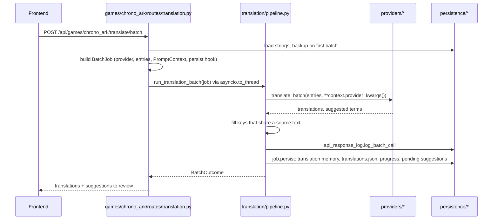

# Backend

The FastAPI server behind the dashboard. It scans Steam Workshop mods, extracts their strings, translates them through a pluggable provider, and writes the results back in each game's own file format. Every game plugs in as an adapter, and they all share one translation pipeline, glossary system and data layer. State lives in JSON files under `backend/storage/`, so there is no database to run.

```bash
yarn start               # from the repo root: Vite + this server together
python -m backend.app    # this server alone, on 127.0.0.1:8008
python -m backend.cli    # headless Chrono Ark CLI (extract, translate, status, glossary, export)
```

## Package map

```text
backend/
  app.py               FastAPI app: startup migrations, localhost CORS, error handler, router mounting
  cli.py               command-line entry point, calling the same services as the API
  process_manager.py   start/stop for Ollama and llama-server
  steamcmd_installer.py
  text_utils.py
  core/                settings, .env writer, errors, atomic JSON writes, storage paths, "open in OS"
  models/              shared pydantic schemas: api.py (requests/responses), loc.py (LocString)
  providers/           Claude, OpenAI, DeepL, Ollama, llama.cpp, Manual, plus factory.py (get_provider)
  translation/         game-agnostic engine: pipeline, streaming, planning, prompt, status, suggestions, rename, orchestrator
  persistence/         per-game stores: translations, glossary, suggestions, history, API log, settings, context, TM, progress
  routes/              game-agnostic HTTP only: settings, ollama, llamacpp, steamcmd, plus shared web-provider helpers
  games/
    base.py            GameAdapter base class and ModInfo
    registry.py        game id -> adapter class
    capabilities/      TranslationCapability, the mixin for games that translate strings
    chrono_ark/        adapter, CSV/DLL/GData extractors, mod scanner, services/, routes/
    total_war_warhammer_3/
                       adapter, paths, loc/ (extract, pack, writeback), translation/, stores/,
                       registry/ (compat-pack registry), workshop/ (publishing), routes/
  migrations/          one-time storage migrations, run at startup
  tests/               pytest, mirroring the package tree
```

Routes stay thin. They validate the request, then call a service or the pipeline. Domain logic lives in `translation/`, `persistence/` and each game's own subpackages.

## Request flow: one translation batch

The frontend loops over the batch plan from `POST /translate/preview` and sends each batch to the game's `/translate/batch` route. Chrono Ark is shown below. Warhammer III takes the same path with its own persistence hook.



If the provider call fails, the pipeline logs the error and raises `BatchError`, which the error handler turns into a 502. Local models use `/translate/batch/stream` instead. Both games hand that route to `translation/streaming.py`, which streams tokens over SSE, then passes the finished result to `record_batch` for the same fill, log and persist steps. `/translate/cancel` stops a streaming batch through the same module.

## Adding a game

1. Create `games/<game_id>/adapter.py` with a class that subclasses `GameAdapter`, plus `TranslationCapability` if it translates strings. Implement `game_id`, `display_name`, `icon`, `capabilities` and `router`. Add `settings_schema` and `on_register()` if the game needs them.
2. Build the router in `games/<game_id>/routes/` with the prefix `/api/games/<game_id>`. For translation, reuse `plan_batches()` for the preview, `PromptContext.for_adapter()` for the prompt, and `BatchJob` / `run_translation_batch()` for each batch. The game only chooses which entries to send and supplies the persist hook.
3. Add the class to `_ADAPTERS` in `games/registry.py`. `app.py` mounts its router automatically.
4. Put game-specific settings in a nested section of `core/settings.py`, as `tw3` does.
5. Add tests under `tests/games/<game_id>/`.

`chrono_ark/` is the reference for a translation-only game. `total_war_warhammer_3/` is the reference for a game with extra tooling.

## Storage layout and migrations

```text
backend/storage/
  games/<game_id>/
    glossary.json              base-game glossary
    translation_memory.json    reused translations across mods
    mods/<workshop_id>/
      translations.json        saved translations and the provider of each key
      glossary.json            per-mod glossary
      pending_suggestions.json glossary terms waiting for review
      character_context.json   mod and character notes for the prompt
      mod_settings.json, prompt_options.json, api_responses.json, progress.json
      history/                 backup folders, each with a meta.json
      ...                      game-specific files (original CSVs, parent snapshots, published baselines)
  bin/  models/  logs/  steamcmd/   managed llama.cpp, GGUF models, process logs, SteamCMD
  _migrations/                      marker files for finished migrations
```

Always build paths through `core/paths.py` (`GameStorage`, `game_storage_path`, `safe_child`) instead of joining strings, so a mod id cannot escape its folder.

`migrations/` holds the `migrate_storage_vN_to_vN+1.py` scripts. `app.py` runs them in order at startup. Each one writes a marker file when it finishes, so later runs do nothing. To change the layout, add the next version with a `run_migration()` function and call it from the lifespan.

## Settings and .env

`core/settings.py` defines one pydantic-settings `Settings` object, read from environment variables with the `SWMT_` prefix and from `backend/.env`. Game-specific settings are nested, e.g. `SWMT_TW3_RPFM_CLI_PATH` maps to `settings.tw3.rpfm_cli_path`. The Settings page changes values at runtime by assigning to `settings` and saving them with `core/env_file.py`, which keeps the comments in `.env` and quotes values safely. The root README lists the variables.

## Testing

```bash
python -m pytest backend      # from the repo root
yarn lint:backend             # ruff + pyright
yarn format                   # also runs ruff format on the backend
```

Install the tools with `pip install -r backend/requirements-dev.txt`.

`tests/conftest.py` has an autouse `isolated_storage` fixture. It points `settings.storage_path`, the llama.cpp models folder and the `.env` path at a temporary folder, and restores the environment afterwards. Tests must never read or write the real `backend/storage` or `backend/.env`. `tests/test_isolation.py` checks this. Shared fixtures such as `sample_loc_string` also live in `conftest.py`.

## Conventions

- **Errors:** raise `DomainError` (400), `NotFoundError` (404) or `UpstreamError` (502) from `core/errors.py`. One handler in `app.py` turns them into `{"detail": "..."}`, so routes do not need their own `HTTPException` for these cases.
- **Async vs sync handlers:** a plain `def` route runs in FastAPI's thread pool, so use it for blocking work. An `async def` route must not block, so it wraps file IO, provider calls and subprocesses in `asyncio.to_thread`. SSE routes need `async def`, so they follow this rule.
- **Atomic writes:** write JSON with `write_json` and text with `write_text_atomic` from `core/json_store.py`. Both write a temp file and replace the target, so a crash cannot leave a half-written file.
- **Game ids everywhere:** persistence functions take a `game_id` and never default to a game.
- **Docs:** one-line docstrings with `Args` and `Returns`, no `Raises`. Comments explain why, not what.
